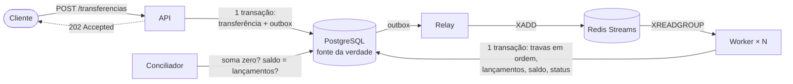

# Motor de liquidação de transferências instantâneas

[](https://github.com/araujovito/liquidacao-pix/actions/workflows/ci.yml)

> **English summary.** An instant-payment settlement engine in Go, modelled on
> Brazil's PIX. A thin API accepts transfer requests and answers `202` only
> after the transfer **and** a transactional outbox row are committed to
> PostgreSQL; a relay copies the outbox to Redis Streams; workers settle each
> transfer in one database transaction against a **double-entry ledger**.
> The point of the project is not the happy path but the guarantees, each
> backed by a test: no accepted request is lost, none is settled twice, money
> is conserved, and the audit-relevant state survives `SIGKILL` on any
> component and the total loss of the queue. A chaos test kills Redis, the
> worker, PostgreSQL, the relay and the API under load, then wipes the stream,
> and verifies every accepted transfer ends settled exactly once with the
> ledger reconciled. Metrics, alerts, dashboards and distributed tracing are
> included. **Try it:** `make demo` (Docker only, ~40 s). Design notes live in
> [`docs/adr/`](docs/adr), limits and measured numbers are stated honestly
> below. The documentation is in Portuguese.

Um motor que recebe pedidos de transferência instantânea no formato do PIX,
responde em poucos milissegundos e liquida de forma assíncrona. O objetivo não
é o caminho feliz: é **provar**, com testes e medições, o que acontece quando
as coisas dão errado.

## Veja funcionando

```sh
git clone https://github.com/araujovito/liquidacao-pix && cd liquidacao-pix
make demo        # ~40 s; precisa só de Docker e curl
```

A demonstração sobe tudo, transfere, mostra a idempotência, **derruba o worker
no meio** e mostra que as transferências aceitas durante a queda são todas
liquidadas quando ele volta, e termina com a conciliação do livro-razão.

```text
▶ 5. Falha controlada: derrubo o worker e continuo recebendo pedidos
  ✓ a API segue aceitando (202): 15 transferências PENDENTE, 15 mensagens esperando no stream
▶ 6. Recuperação: religo o worker; ele consome o que ficou esperando
  ✓ as 15 transferências aceitas durante a queda foram todas liquidadas
▶ 7. Conciliação do livro-razão ...
  ✓ conciliação fechada, sem divergências
```

Para ver métricas, painel e traces: `make observabilidade` (Grafana em
`localhost:3001`, Jaeger em `localhost:16686`).

## Como funciona



1. **API** valida o pedido, grava a transferência (`PENDENTE`) e uma linha na
   *outbox* **na mesma transação** e só então responde `202`. A fila não é a
   fonte da verdade: o `202` nunca depende do Redis estar de pé.
2. **Relay** copia a outbox para um *Redis Stream* (`FOR UPDATE SKIP LOCKED`,
   pode haver várias instâncias). Pode publicar duas vezes; quem garante "uma
   vez só" é o worker.
3. **Worker** abre uma transação, trava a transferência e as duas contas **em
   ordem crescente de id** (evita *deadlock*), grava dois lançamentos
   (débito e crédito) e finaliza. Se a transferência já está final, não faz nada.
4. **Conciliador** confere periodicamente as invariantes do livro-razão e
   expõe o resultado como métrica.

O dinheiro é inteiro em centavos, os lançamentos são **imutáveis** (um gatilho
no banco recusa `UPDATE` e `DELETE`) e o saldo da conta é uma projeção mantida
na mesma transação. O dinheiro entra no sistema por uma conta técnica de
liquidez, a única que pode ficar negativa, de modo que a soma de **todos** os
lançamentos é sempre zero.

## O que é provado, e como

| Garantia | Como é provada |
|---|---|
| Nenhum pedido aceito se perde | Outbox transacional. O [teste de caos](tests/caos/main.go) dá `SIGKILL` em Redis, worker, Postgres, relay e API durante a carga e depois **apaga o stream inteiro**: 55.938 pedidos aceitos, todos liquidados, 0 perdidos |
| Nenhum pedido é liquidado duas vezes | Trava na transferência + `UNIQUE (transferencia_id, conta_id)` no banco. Teste com 4.000 transferências, cada uma entregue **duas vezes** ao mesmo tempo por 32 goroutines |
| O dinheiro é conservado | Partidas dobradas, lançamentos imutáveis, [conciliação](internal/repository/conciliacao.go). Um teste adultera 1 centavo de saldo e exige que a conciliação acuse |
| Sem *deadlock* em transferências cruzadas (A→B e B→A) | Travas em ordem fixa. **Mutação:** sem a ordenação o teste falha com 189 *deadlocks* |
| Idempotência na API | `end_to_end_id` único decidido pelo banco, não por consulta prévia. 20 pedidos iguais simultâneos geram 1 transferência |
| A fila se recupera de falhas | Streams com `XCLAIM`, espera crescente, mensagens mortas e varredura de órfãs. Perda total do Redis converge (17.956 recuperadas pela varredura na última rodada de caos) |
| Dado sensível fora de métricas e traces | Rótulos de baixa cardinalidade; teste percorre todos os atributos de todos os spans e falha se achar chave PIX ou `end_to_end_id` |
| Os alertas disparam quando devem | `make testar-alertas` (séries sintéticas) **e** prova contra o Prometheus real, derrubando Redis e relay |

Vários testes foram validados por **mutação** (estrago o código de propósito e
confiro que o teste falha). Está registrado nos commits.

### O que o teste de caos achou

Três defeitos reais, corrigidos com teste de regressão, descritos em
[`MEMORIA_TECNICA.md`](MEMORIA_TECNICA.md): a varredura de mensagens perdidas
republicava 14 mil mensagens que só estavam esperando; ela também era lenta
demais para convergir; e os workers ficavam presos em `NOGROUP` depois que o
stream era apagado. Nenhum passava nos testes de unidade ou de integração.

## Desempenho medido

Notebook AMD Ryzen 7 7735HS (16 threads, 13 GB), **tudo na mesma máquina**,
incluindo o gerador de carga. Os números servem para comparar versões, não
como capacidade de produção. Método e relatórios completos em
[`docs/carga.md`](docs/carga.md).

| Cenário | Resultado |
|---|---|
| Carga sustentada, 1.000 pedidos/s por 3 min | 0 erro, 0 descarte; API p50 3,2 ms, p95 7,7 ms, p99 19,7 ms |
| Pico (até 4.000 pedidos/s) | o conjunto satura em ~2.500–2.900 pedidos/s; API e worker disputam o mesmo Postgres |
| Worker com 8 consumidores a 1.500/s | gargalo: fila cresce sem parar. **O padrão passou a 32** |
| Rastreamento a 100% de amostragem | sem custo mensurável a 1.000/s |

**Limites do que foi medido, por escrito:** acima de ~1.250 pedidos/s a API tem
pausas de 1 a 14 s cuja causa **não** encontrei (o `autoanalyze` do Postgres foi
testado e descartado; os checkpoints não se alinham); a taxa sustentada
comprovada é, portanto, 1.000/s nesta máquina.

## O que este projeto **não** garante

Honestidade sobre os limites faz parte do projeto:

- **Não é PIX de verdade.** Sem SPI, DICT, ISPB reais nem liquidação
  interbancária; só o formato do `end_to_end_id` e a ideia.
- **Sem autenticação** na API (declarado em [`docs/openapi.yaml`](docs/openapi.yaml)).
  Um sistema real exigiria mTLS/OAuth e idempotência por cliente.
- **Um único Postgres**, sem réplica nem *failover*. A resiliência demonstrada
  é a dos componentes ao redor do banco e a de reinícios do próprio banco.
- **Sem Alertmanager:** os alertas aparecem na interface do Prometheus, mas
  nenhuma notificação sai.
- **Auditoria criptográfica e proteção de dados pessoais ainda não existem**
  (cadeia de hashes com HMAC, CPF cifrado, apagamento por descarte de chave).
  Estão no [roteiro](docs/roteiro.md), fase 7.
- `CREATE INDEX` das migrações é bloqueante; em tabela grande exigiria outro
  procedimento.

## Estrutura

```text
cmd/            api · relay · worker · conciliador · migrar · semear
internal/
  domain/       entidades e regras puras (dinheiro, validação, decisão de liquidação)
  usecase/      aceitar pedido, liquidar, relay, worker, conciliador
  repository/   Postgres (pgx, SQL à mão): travas, outbox, conciliação
  queue/        Redis Streams
  web/          handlers HTTP (problem details, RFC 9457)
  metricas/     métricas Prometheus
  telemetria/   rastreamento OpenTelemetry
db/migrations/  SQL versionado
deployments/    Dockerfile, Compose, Prometheus, regras de alerta, Grafana
tests/          caos · carga (k6) · demo
docs/           ADRs, runbook, OpenAPI, observabilidade, carga, especificação
```

## Documentação

| Documento | Conteúdo |
|---|---|
| [`docs/adr/`](docs/adr) | Decisões de arquitetura e o que foi descartado |
| [`docs/runbook.md`](docs/runbook.md) | O que fazer quando a fila cresce, há mensagens mortas, a conciliação diverge |
| [`docs/openapi.yaml`](docs/openapi.yaml) | Contrato da API |
| [`docs/observabilidade.md`](docs/observabilidade.md) | Métricas, alertas, painel, rastreamento |
| [`docs/carga.md`](docs/carga.md) | Testes de carga: método, resultados, limites |
| [`MEMORIA_TECNICA.md`](MEMORIA_TECNICA.md) | Estado, decisões em vigor e histórico, incluindo hipóteses refutadas |
| [`docs/especificacao.md`](docs/especificacao.md) | A especificação, com a tabela do que foi corrigido na ideia original |

## Para desenvolver

Precisa de Go 1.27 e Docker.

```sh
make teste           # tudo; os testes de integração sobem Postgres e Redis em contêineres
make teste-unidade   # só o que não precisa de Docker
make lint            # gofmt, go vet, golangci-lint
make caos            # teste de caos contra o sistema em contêineres (~2 min)
make carga-sustentada   # k6
make testar-alertas  # regras de alerta com promtool
```

## Licença

[Apache License 2.0](LICENSE). Copyright 2026 Vitor Barbosa Araujo (ver [`NOTICE`](NOTICE)).

